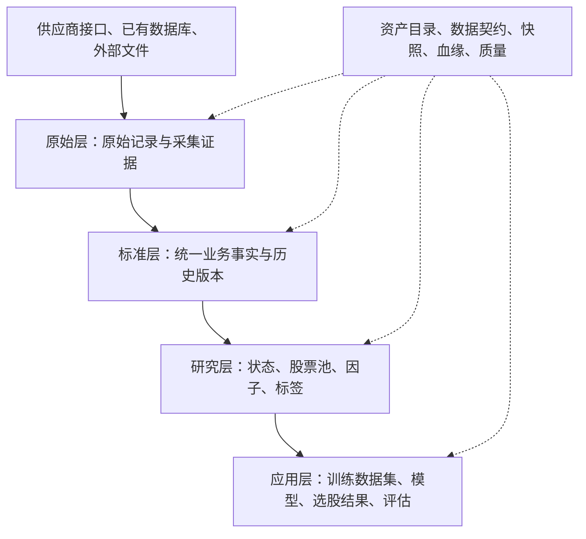

# 量化选股数据资产体系设计

本文定义从数据接入、标准化、研究加工到模型训练和选股结果的整体数据资产体系，作为后续实现与验收的目标设计。现有数据来源和脚本依赖见 [基本数据](基本数据.md)，运行方式见 [README](../README.md)。

## 一、目标与建设范围

首期服务 A 股日线多因子选股，默认在 T 日晚间形成决策、T+1 执行。`decision_time` 表示实际决策截止时间，由策略配置确定。分钟数据用于后续执行研究，财务、行业和事件数据按各自的业务频率维护。

体系需要支持以下工作。

| 使用场景 | 需要交付的数据资产 |
| --- | --- |
| 历史行情与市场研究 | 有稳定证券标识、统一单位和历史版本的基础数据 |
| 因子研究 | 可追溯输入、计算定义和预处理过程的因子截面与时间序列 |
| 模型训练与验证 | 固定股票池、特征、标签及时间切分的数据集版本 |
| 每日选股 | 指定决策时点的候选股票、分数、排名及排除原因 |
| 回测与复盘 | 当时可用的数据快照、模型版本、选股结果和评估结果 |

资产范围覆盖证券主数据、行情与交易状态、财务、公司行动、资金流、行业与指数，以及由它们产生的股票池、因子、标签、数据集和选股结果。模型文件与评估报告纳入资产追溯，交易订单和成交由执行系统产生，并可作为后续评估的输入。

建设按业务需求逐步扩展。首期以现有行情、资金流、行业和指数数据为基础，补齐 ST 历史、停复牌和数据版本管理。财务与公司行动作为下一阶段的核心资产。公告文本、业绩预告、分析师预期、股东行为、宏观数据和分钟行情按策略需求接入，并沿用相同的时间与版本规则。

## 二、总体架构

采用四个数据层次，以及贯穿各层的资产目录、版本、血缘和质量管理。

| 层次 | 保存内容 | 主要产物与职责 |
| --- | --- | --- |
| 原始层 `raw` | 接口原始回包、数据库抽取、外部文件及请求参数 | 保留源字段、源单位、获取时间和文件校验值，支持重新加工 |
| 标准层 `standard` | 证券身份、行情、财务、状态事件、行业与指数关系 | 统一标识、粒度、单位和历史查询规则，形成可复用的业务事实 |
| 研究层 `research` | 日频状态、财务衍生指标、市场特征、股票池、因子、标签 | 按固定定义和输入快照计算，保存具有复用价值的研究结果 |
| 应用层 `application` | 训练数据集、实验与模型、预测分数、选股名单、评估报告 | 绑定研究目标、时间切分、模型与执行假设，形成可交付版本 |

- 每个资产都有唯一 `asset_id`、负责人、数据契约和发布版本。数据库表、Parquet 数据集、模型文件和报告都可以登记为资产。
- 层次由独立库、schema 或目录区分。保留项目的 `ts_basic_*`、`ts_quotation_*`、`ts_finance_*`、`ts_idx_*` 命名，新增加工资产使用 `ts_feature_*`，模型与选股产品使用 `ts_model_*`。
- `ts_*` 表示项目命名。供应商身份记录在资产契约与采集批次中，外部行业和同花顺数据沿用各自的来源标识。
- 同一业务事实在标准层有确定的来源选择规则。供应商切换、字段含义变化、计算口径变化需要新契约版本和影响评估。
- 下文表格描述逻辑资产与核心字段。物理建表、分区和索引在各资产落地时确定。

## 三、统一标识与历史口径

### 1. 公司、证券与代码

- `company_id` 标识公司主体，财务报表按公司归属。
- `stock_id` 标识上市证券，行情、交易状态、分红和选股结果按证券归属。退市后保留该标识，同一公司发行的不同证券分别登记。
- 供应商代码通过 `source, ts_code` 和有效期映射到 `stock_id`。代码变更、代码复用和跨来源映射都保留历史。
- `index_id` 标识确定的指数序列，登记编制方、代码、币种及价格指数或全收益指数口径。
- 行业使用 `classification_id, industry_code` 标识，`classification_id` 包含分类体系及版本，例如 `SW2021`。

日频样本以 `stock_id, trade_date` 为基础索引。当前上市状态、当前名称和当前成分不能直接决定整个历史样本范围。每个历史决策日从当时的证券登记、上市状态和成分关系构建候选全集，覆盖后来退市、改名或被剔除的证券。

### 2. 三类时间

| 时间 | 字段示例 | 含义 |
| --- | --- | --- |
| 业务时间 | `trade_date, end_date, in_date, out_date` | 行情发生日、财务报告期或业务关系的生效区间 |
| 市场可知时间 | `known_time` | 有证据支持该版本对市场可知的最早时间，包含约定的信息延迟 |
| 系统记录与发布时间 | `recorded_time`、批次 `published_time` | 系统实际保存该版本、以及完成校验并对下游提供该批次的时间 |

所有时间戳保存 UTC，交易日和公告日按 Asia/Shanghai 解释。日期使用 `DATE`，时间戳使用能保留微秒的类型。

数据契约记录 `known_time` 的确定方法，包括原始发布时间、仅有公告日期时的保守延迟规则、首次历史快照时间。只有公告日期时，默认从下一交易日的决策时点使用，具体规则随契约版本固定。报告期末、行情日期和系统回填时间各自保留。

财报修订使用修订版本的公开时间。今天取得的最终修订值，只有在存在相应历史版本与发布时间证据时，才能用于更早时点的研究。证据不足的历史段登记其覆盖限制，并保留原始来源供追溯。

### 3. 两种回放方式

| 方式 | 可用数据条件 | 用途 |
| --- | --- | --- |
| 市场历史研究 | 输入快照固定，且每个版本满足 `known_time <= decision_time` | 使用可验证的历史版本研究当时市场信息 |
| 系统运行回放 | 进一步要求 `recorded_time <= decision_time`，且所用批次已在该时点发布 | 还原本系统当时实际得到和使用的数据 |

回放方式写入数据集和实验清单。重新采集得到的历史数据可以生成新的市场研究版本，原有系统运行记录仍引用当时使用的批次。

### 4. 版本化查询

标准层可修订记录统一保留 `version_id, revision_no, batch_id, known_time, recorded_time, is_deleted`。`version_id` 唯一标识一个版本，业务键标识该版本描述的事实。来源优先级在标准化时确定并随契约版本固定，原始层保留全部来源记录。

`revision_no` 表示同一事实的已确认修订顺序，依据来源修订标识、公开证据或核验结果确定。同一来源版本重复采集时复用其版本身份，较早版本的重新下载保持原修订顺序。可知时间相同而内容冲突时，先确定修订顺序再发布。

区间关系使用稳定的 `relation_id` 或 `history_id` 标识同一段业务事实，`in_date, out_date` 是可修订字段。通过来源事件标识或持久映射维护身份，使重采和日期更正仍对应同一关系。区间拆分或合并时，原关系通过撤销版本退出，新关系在同一发布批次中生效。

历史查询顺序统一为以下步骤。

1. 读取快照清单列出的完整输入批次集合，包含有效版本、修订和撤销记录。
2. 按回放方式筛选满足决策时点要求的版本。
3. 按业务键选择最新有效版本，按 `known_time, revision_no` 确定顺序，再排除 `is_deleted = 1` 的记录。
4. 对区间表筛选业务日期落在 `[in_date, out_date)` 内的记录。`out_date` 为空表示持续有效。
5. 按统一标识关联所需资产，保留缺失与覆盖状态。

`业务键 + revision_no` 唯一对应一个不可变版本，同一批次中的同一事实版本不得重复。区间边界、证券映射、行业归属和字典也参与版本与快照管理。当前状态视图由上述规则生成。

## 四、标准层核心资产

表格中的业务键用于识别事实，历史版本另外携带第三节的公共技术字段。字段清单保留核心内容，完整字段类型、空值规则和源字段映射由数据契约维护。

### 1. 证券与交易日历

| 资产 | 粒度 / 业务键 | 核心业务字段 |
| --- | --- | --- |
| `ts_basic_company` | 公司主体 / `company_id` | `company_id, company_name` |
| `ts_basic_stock_list` | 上市证券 / `stock_id` | `stock_id, security_type, list_date` |
| `ts_basic_stock_code` | 一段代码映射 / `relation_id` | `relation_id, stock_id, source, ts_code, in_date, out_date` |
| `ts_basic_stock_history` | 一段证券属性历史 / `history_id` | `history_id, stock_id, company_id, exchange, name, market, list_status, in_date, out_date` |
| `ts_basic_trade_cal` | 交易所的一天 / `exchange, cal_date` | `exchange, cal_date, is_open` |

代码映射在同一来源和有效时点应唯一。证券属性历史按真实变更记录或历史快照整理，记录首次覆盖日期。退市日期可由上市状态历史提取，上下交易日按交易所日历生成。

### 2. 行情、股本与资金流

| 资产 | 粒度 / 业务键 | 核心业务字段 |
| --- | --- | --- |
| `ts_quotation_daily` | 股票日行情 / `stock_id, trade_date` | `open, high, low, close, pre_close, vol, amount` |
| `ts_quotation_adj_factor` | 股票日复权因子 / `stock_id, trade_date` | `adj_factor` |
| `ts_quotation_daily_basic` | 股票每日指标 / `stock_id, trade_date` | `total_share, float_share, free_share, total_mv, circ_mv, turnover_rate, turnover_rate_f, volume_ratio, pe, pe_ttm, pb, ps, ps_ttm, dv_ratio, dv_ttm` |
| `ts_quotation_moneyflow` | 股票每日分单资金流 / `stock_id, trade_date` | 小单、中单、大单、特大单的买卖量与金额，以及来源提供的净流量 |

- 行情以未复权价格作为基础事实。`pre_close` 保留来源的昨收参考价，可能受除权影响。涨跌幅、收益率和复权价格由明确公式生成。
- 每日指标保留供应商口径及其来源，便于解释和复现已有研究。自行计算的 PIT 估值、换手率和财务指标登记为独立加工定义，记录分母、股本和财务版本。
- 资金流沿用供应商的分单分类标准，其买卖净额属于该分类下的统计结果。跨来源比较前先确认分类方法和单位。
- 按证券日历生成预期样本，再关联行情和辅助资产。辅助数据缺失保留状态，由具体因子和股票池规则决定是否使用该样本。

### 3. ST、停复牌与涨跌停

| 资产 | 粒度 / 业务键 | 核心业务字段 |
| --- | --- | --- |
| `ts_basic_stock_st` | 当日 ST 名单中的股票 / `stock_id, trade_date` | `name, type, type_name`，保留当日来源名称与分类 |
| `ts_quotation_suspend_d` | 一次停复牌记录 / `suspend_event_id` | `suspend_event_id, stock_id, trade_date, suspend_type, suspend_start_time, suspend_end_time` |
| `ts_quotation_stk_limit` | 股票每日限价 / `stock_id, trade_date` | `up_limit, down_limit, limit_type` |

ST 信息采用每日历史名单。`stock_st` 的输出含当日名称和类型，类型字段本身可能同时覆盖 ST 与 \*ST，细分状态需要结合当日名称或其他已核实来源。[Tushare ST 股票列表](https://tushare.pro/document/2?doc_id=397)

ST 名单和停牌名单都需要对应的日期覆盖记录。只有已确认当日名单完整，名单外股票才可推导为正常状态。请求失败、尚未采集和成功返回空名单分别记录。

停牌按全天、盘中区间和复牌事实保存。限价区分有限价、无限价和未知，空价格需结合来源语义解释。综合日频状态在研究层计算，同时保存各输入的批次。

### 4. 财务与公司行动

| 资产 | 粒度 / 业务键 | 核心业务字段 |
| --- | --- | --- |
| `ts_finance_income` | 公司某报告期的利润表 / `company_id, end_date, report_scope, period_type` | `ann_date, f_ann_date, report_type, total_revenue, revenue, oper_cost, rd_exp, operate_profit, n_income, n_income_attr_p` |
| `ts_finance_balancesheet` | 公司某报告期的资产负债表 / `company_id, end_date, report_scope, period_type` | `ann_date, f_ann_date, report_type, total_assets, total_liab, total_hldr_eqy_exc_min_int, money_cap, inventories, accounts_receiv, total_cur_assets, total_cur_liab, st_borr, lt_borr, non_cur_liab_due_1y` |
| `ts_finance_cashflow` | 公司某报告期的现金流量表 / `company_id, end_date, report_scope, period_type` | `ann_date, f_ann_date, report_type, n_cashflow_act, n_cashflow_inv_act, n_cash_flows_fnc_act, c_pay_acq_const_fiolta` |
| `ts_basic_dividend` | 一次分红送转方案 / `event_id` | `event_id, stock_id, ann_date, record_date, ex_date, pay_date, div_listdate, cash_div_tax, stk_bo_rate, stk_co_rate, div_proc` |
| `ts_basic_corporate_action` | 一次其他公司行动 / `event_id` | `event_id, stock_id, event_type, ann_date, effective_date, event_status, detail_uri` |

- 首期研究默认使用合并报表。利润表与现金流量表保留年初至今累计口径，资产负债表保留期末口径，分别在 `report_scope, period_type` 中明确。源 `report_type` 和公告日期保留用于核对。
- 同一报告期的原始披露、后续更正和重述按各自可知时间形成版本。会计口径不兼容时，在契约中规定可比范围和转换规则。
- 公司与证券关联也按历史版本查询。财务资产以公司为粒度，股票因子按当时的公司归属取得报表。
- 单季、TTM、同比、ROE、毛利率等在研究层计算，使用当时已知且口径兼容的报告版本。累计流量通过同年度累计值相减得到单季，资产负债表使用时点值。金融企业采用适用的字段集合和因子定义。
- 分红方案沿用稳定事件标识，实施、修改和取消均留存版本。每股现金、送转比例及税前税后含义在契约中注明。
- 其他公司行动覆盖配股、合并换股、证券终止与结算等。`detail_uri` 引用按事件类型定义的结构化明细和原始证据。影响持有收益的事件进入标签与回测处理规则，暂不可处理的事件产生明确状态。

财务源字段和报告类型参见 [Tushare 利润表](https://tushare.pro/document/2?doc_id=33)。PIT 数据的查询与历史版本方式可参考 [RQData 财务数据说明](https://www.ricequant.com/doc/rqdata/python/stock-mod)。

### 5. 行业、指数与市场环境

| 资产 | 粒度 / 业务键 | 核心业务字段 |
| --- | --- | --- |
| `ts_idx_industry_classify` | 一个分类体系的行业 / `classification_id, industry_code` | `industry_name, level, parent_code` |
| `ts_idx_industry_cons` | 一段行业归属 / `relation_id` | `relation_id, stock_id, classification_id, industry_code, in_date, out_date` |
| `ts_idx_index_list` | 一个确定的指数序列 / `index_id` | `index_id, provider, index_code, index_name, currency, return_type` |
| `ts_idx_index_cons` | 每日指数成分 / `index_id, stock_id, trade_date` | `index_id, stock_id, trade_date` |
| `ts_idx_index_weight` | 一次成分权重观测 / `index_id, stock_id, observation_date` | `weight` |
| `ts_idx_index_daily` | 指数日行情 / `index_id, trade_date` | `open, high, low, close, pre_close, vol, amount` |
| `ts_idx_market_observation` | 来源提供的指数统计 / `index_id, trade_date, metric_code` | `metric_value`，指标定义与来源由契约确定 |

- 外部行业数据整理为分类字典和叶子行业归属，上级行业由字典查询。单一分类体系内，同一证券的有效归属区间不得重叠。只有当前行业快照时，历史覆盖从有证据的日期开始。
- 指数成分保留经过验证的每日快照。由进出记录加工时，需明确起始成分、调整生效日与交易日历，逐日还原并校验。月度权重按观测日期保存，使用时记录其时效和延用规则。
- 同花顺 `ths_idx_index_daily` 中的基础行情进入标准指数行情，涨跌家数、涨停占比等统计值进入市场观测资产。研究层引用这些观测或自行计算特征，自行统计时使用该历史日的成分与行情，计算定义与供应商统计分别登记。

### 6. 单位与空值

| 数据 | 标准层约定 |
| --- | --- |
| 股票价格 | 人民币元，建议 `DECIMAL(20,6)` |
| 金额、市值、财务金额 | 人民币元，建议 `DECIMAL(28,4)` |
| 成交量、股本 | 股，按来源精度换算并校验，保留供应商取整信息 |
| 指数价格 | 指数点位，指数币种和收益口径由指数登记表定义 |
| 比率、收益率、权重 | 小数，例如 `0.02` 表示 2%，估值倍数按倍数保存 |
| 事件现金与股份比例 | 每股金额或每股比例，定义写入字段契约 |

原始层保留原单位。标准化时显式换算手、千元、万元、万股和百分比。未知、不适用、数据缺失和分母为零使用 `NULL`，并通过记录状态或质量报告说明原因。零值表示真实观测到的零。

## 五、研究层资产

### 1. 可复用加工数据

| 资产 | 粒度 | 内容与用途 |
| --- | --- | --- |
| `ts_feature_stock_status` | `batch_id, stock_id, trade_date` | `risk_status, trade_status, limit_type, up_limit, down_limit, coverage_status` |
| `ts_feature_financial_daily` | `batch_id, stock_id, trade_date` | 截至决策时间可用的单季、TTM、增长率、盈利与估值指标 |
| `ts_feature_market_daily` | `batch_id, index_id, trade_date, metric_code` | 指数成分的广度、涨跌分布、波动和流动性特征 |
| `ts_model_stock_pool` | `batch_id, stock_id, trade_date` | 被评估证券的资格、首要排除原因及数据完整性状态 |
| `ts_model_stock_factor` | `batch_id, stock_id, trade_date, factor_code` | `factor_value, value_status` |
| `ts_model_stock_label` | `batch_id, stock_id, trade_date, label_code` | 标签值、起止日期、成熟时间和状态 |

每个加工批次固定定义版本、输入快照、决策时点规则与计算环境。同一日期存在多个决策时点时，分别生成批次，并能从日期和清单唯一还原 `decision_time`。基础表中的业务版本与加工结果的批次版本分别管理。

首期市场环境特征以登记指数的成分为统计范围，批次引用对应成分快照和指标定义。

加工特征的可知时间至少覆盖全部输入版本的可知时间及定义约定的处理延迟。市场历史研究据此检查时点，系统运行回放进一步使用实际批次发布时间。

### 2. 股票池

先构造历史候选全集，再应用上市时长、市场范围、ST、停牌、流动性和数据覆盖等规则。每个被评估证券保存 `is_eligible, exclude_reason`，完整排除明细作为批次附件。因子需要的特有字段通过因子覆盖状态表达。

T 日决策使用截至 T 日决策时点的信息。T+1 开盘前更新的 ST、停牌或限价信息可以用于执行前复核，并保存独立的复核结果。T+1 的实际成交条件和成交结果进入执行评估。

### 3. 因子定义与预处理

因子登记 `factor_code, definition_version`，定义包括经济含义、公式、输入资产、历史窗口、可知时间规则、缺失处理、适用范围和计算代码版本。

- 原始因子和经过缩尾、标准化、中性化的因子分别发布，批次清单固定预处理顺序与参数。
- 横截面处理固定当日参考股票池、行业和市值版本。跨时间学习的填充值、缩放参数、特征选择器和降维模型仅在训练区间拟合，并保存拟合产物。
- 长表作为因子结果的逻辑模型，训练宽表按数据集清单生成。物理存储可按因子族组织列式文件。
- 复权价格明确锚定日期和因子版本。历史特征的构造使用截至决策时点可用的输入，未来公司行动用于相应未来收益的计算。

### 4. 标签

标签定义登记入场时点、出场时点、持有期日历、价格口径、基准、成本和公司行动规则。`label_code` 区分不同目标，版本变化产生新的定义与批次。

标签记录至少包含 `entry_date, exit_date, label_value, label_known_time, label_status`。`label_known_time` 表示所需未来行情及事件结果均已可知的时间，实际运行还受标签批次发布时间约束。

日线价格收益标签和包含停牌、限价、成交量约束的执行收益标签分别定义。无法入场、无法按期出场、样本尾部截断、退市待结算和数据缺失都保存状态。使用复权收益或显式现金分红处理时，计算定义统一公司行动的计入方式，防止重复计入。

## 六、应用层交付

| 资产 | 标识或粒度 | 保存内容 |
| --- | --- | --- |
| `ts_model_dataset` | `dataset_id` | 数据集清单、样本索引、特征与标签版本、切分方案、预处理产物、文件位置与校验值 |
| `ts_model_experiment` | `experiment_id` | 数据集、训练截止时间、算法、超参数、随机种子、代码与环境、模型文件、评估报告 |
| `ts_model_stock_score` | `batch_id, stock_id, trade_date` | `model_id, score, rank, score_status`，以及所用实验或规则定义 |
| `ts_model_selection` | `batch_id, stock_id, trade_date` | 候选全集中的入选状态、排名、选择原因，以及策略需要时的目标权重 |
| 评估与复盘报告 | `evaluation_id` | 输入结果批次、基准、成本与执行假设、指标、分组分析、异常样本和报告文件 |

`model_id` 标识不可变的模型文件及其预处理产物，由实验清单登记。规则选股登记规则定义与版本，结果批次使用同样的来源追溯方式。评估报告可以先以文件和清单保存，后续按查询需求建立指标表。

训练数据集清单固定以下内容。

- **样本范围**：候选证券、日期区间、决策时点、股票池版本、回放方式和排除规则。
- **输入版本**：特征快照、因子定义与批次、标签快照及成熟性要求。标签可来自之后生成的快照，特征仍使用原先固定的历史输入。
- **时间切分**：训练、验证、测试区间，滚动或扩展窗口，重叠标签的清除规则，以及需要时的间隔期。按标签实际起止区间处理边界重叠。
- **训练约束**：每次拟合只使用训练截止时点已成熟的标签。时间序列拟合产物绑定该训练折，同一折的验证和测试复用该产物。
- **样本对齐**：固定证券与日期索引、列顺序、数据类型和缺失状态。特征与标签按显式键关联，记录关联前后的数量和原因。

因子评估包括覆盖率、稳定性、IC/Rank IC、分组收益、换手和行业市值暴露。选股与回测评估记录收益、回撤、成本、容量假设及无法成交样本。指标定义和计算区间随报告版本一起保存。

## 七、资产目录、血缘与发布

### 1. 资产与版本登记

| 元数据资产 | 标识 | 主要内容 |
| --- | --- | --- |
| `ts_meta_asset` | `asset_id, contract_version` | 名称、层次、负责人、粒度、字段、单位、来源、时间规则、更新频率、覆盖承诺、质量规则、使用权限和存储位置 |
| `ts_meta_definition` | `definition_type, definition_code, definition_version` | 股票池、因子、标签、预处理和选股规则的定义、输入依赖与代码位置 |
| `ts_meta_batch` | `batch_id` | `asset_id, contract_version, run_id, status, recorded_time, published_time, manifest_uri, checksum` |
| `ts_meta_lineage` | `batch_id, input_batch_id` | 输出批次与输入批次的依赖关系 |
| `ts_meta_snapshot` | `snapshot_id` | 一组可一致读取的资产批次、清单、校验值与发布时间 |

一个批次对应一个资产的输出，一次任务运行 `run_id` 可以生成多个批次。清单明确输出是完整快照还是增量，列出覆盖范围、分区、文件校验值、记录数量、代码与环境、参数、定义版本及质量报告。

完整来源快照只替换其声明且验证完整的覆盖范围。转入标准层版本链时，对旧集合中存在而新集合中消失的业务键生成撤销版本，并记录此次更正的可知时间。部分返回和增量响应只更新明确提供的记录。该规则同样适用于 ST 名单、每日指数成分及其他快照型来源。

快照清单包含重建所需的完整批次链。下游显式指定 `snapshot_id`，或在任务开始时一次性解析并固定当前发布快照。共享字典、证券映射和交易日历也随快照确定。

### 2. 质量与覆盖

质量检查结果按资产、批次和日期范围保存，区分阻断发布与允许带标记发布的问题。阈值由资产契约和使用产品确定。

| 检查内容 | 验证要点 |
| --- | --- |
| 身份与唯一性 | 业务版本重复、孤立证券代码、映射冲突、区间重叠 |
| 覆盖与时效 | 应采集日期、预期证券范围、成功空结果、部分返回、延迟与缺失 |
| 业务一致性 | 价格关系、成交量额非负、净流量计算、复权因子、市值与股本口径、财报勾稽关系及容差 |
| 历史可用性 | 版本的公开证据、公告延迟、区间边界、特征输入是否晚于决策时间 |
| 加工质量 | 合并前后样本数、因子覆盖和分布变化、标签成熟率、异常排除比例 |
| 产品复现 | 快照与清单完整、代码与参数可定位、输出校验值或数值误差满足约定 |

状态类稀疏数据额外保存每个交易日的采集结果与完整性证据，避免把一张空表解释为全市场正常。特征缺失允许按定义处理，证券映射冲突和无法解释的版本覆盖需先处理。

### 3. 批次生命周期

1. **接入**：按来源与数据范围采集，保存原始载荷、请求参数和内容校验值。
2. **标准化**：完成身份映射、单位转换、时间确定、来源选择和重复记录处理。
3. **校验**：输出数据质量与覆盖报告，未通过的产物进入隔离区。
4. **发布**：先写完整文件或暂存表，验证后提交批次，并原子更新发布快照指针。
5. **消费**：研究和应用任务固定输入快照，输出新的批次及血缘。
6. **修订**：来源更正或加工逻辑变更生成新版本，计算受影响日期和下游资产，再按依赖重算。

任务重试通过来源、范围、契约和内容校验识别重复输入。并发任务使用唯一约束和发布版本检查避免相互覆盖。失败任务保留诊断与原始输入，已发布内容保持不可变。

回滚通过切换到仍然有效的历史快照完成。历史实验继续引用原输入，重新研究则生成新的数据集或实验版本。

### 4. 存储与访问

初期沿用 MySQL 保存元数据、证券映射和需要事务查询的数据，采用 Parquet 保存批量历史行情、因子截面和训练数据。原始文件、数据清单、模型和报告保存在有版本目录的文件存储中。

建议以 `layer/asset_id/batch_id/` 组织产物，按交易月或业务日期划分数据文件。分区粒度根据数据量和读取方式确定，避免每个股票每天产生独立小文件。CSV 作为兼容现有脚本的导出格式，字段和日期格式由导出契约固定。

研究查询支持指定证券、日期范围、决策时间和快照。批量训练读取固定数据集文件，每日选股读取已发布截面。备份与恢复覆盖数据文件、元数据和清单，资产留存与访问范围结合供应商授权和项目需求确定。

## 八、每日运行与历史重建

以 T 日晚间选股为例，任务按依赖顺序运行。

1. 更新原始行情、每日指标、资金流、状态名单，以及新公告、财报和公司行动。财务与事件按公告增量维护，同时检查历史修订。
2. 标准化并核对日历、证券身份、当日覆盖和单位，形成待发布批次。
3. 在配置的截止时间检查必需资产，生成当日输入快照。必需资产缺失时保留任务失败或延迟状态，可选资产按产品定义执行缺失策略。
4. 基于当时可用数据生成状态、候选股票池、财务衍生指标和因子，发布研究批次。
5. 使用固定模型与预处理产物计算分数、排名和选股名单，保存模型、数据、规则与原因。
6. T+1 执行前按策略需要复核新状态，后续生成成交评估。历史样本随未来信息到齐逐步更新标签批次。

历史回填复用相同标准化与计算定义，逐个决策日执行历史查询。滚动窗口、财报修订、指数调整和公司行动决定重算的影响范围，血缘用于定位需更新的下游批次。

## 九、现有仓库的衔接与落地顺序

### 1. 现有数据的去向

| 现有来源或实现 | 目标资产与调整 |
| --- | --- |
| 已有 `stock_info` 数据库和外部文件 | 纳入原始层抽取与批次记录，建立源字段和覆盖契约 |
| 股票列表及外部行业表 | 建立证券与公司标识、代码映射、行业字典和可验证的历史归属 |
| 股票日线、每日指标、复权、限价和资金流 | 分别形成标准资产，再按证券日期索引关联研究输入 |
| ST 信息表与旧名称过滤逻辑 | 以 `stock_st` 历史名单建设 `ts_basic_stock_st`，基于日期覆盖生成风险状态，逐步切换股票池 |
| 停复牌 CSV 与缺失检查器 | 标准化日期与日内停牌语义，将检查结果纳入质量报告 |
| 指数成分加工草稿 | 核实初始成分和调整生效日，生成可校验的每日成分 |
| 同花顺指数表 | 基础行情和统计观测进入标准层，再生成有来源定义的研究特征 |
| 现有 CSV 导出 | 经标准资产或兼容视图生成，显式选择字段、排序和格式 |

### 2. 分期交付

| 阶段 | 交付范围 | 完成条件 |
| --- | --- | --- |
| 第一阶段：可追溯基础数据 | 原始归档、契约与批次、证券映射、行情资金流、ST/停复牌/限价、行业指数 | 能按固定快照读取历史数据，明确每个日期的覆盖与缺失 |
| 第二阶段：选股研究闭环 | 日频状态、股票池、基础因子、标签、时间切分数据集、规则或模型评分及评估 | 一次研究能从样本追溯到来源，并复现选股结果 |
| 第三阶段：财务与事件 | PIT 财务、公司行动、财务衍生指标和对应因子标签 | 财报修订和公司行动可按历史时点复现，收益口径一致 |
| 第四阶段：持续运行与扩展 | 自动发布、失败重试、时效监控、增量重算、分钟与其他策略所需数据 | 每日选股按截止时间稳定交付，异常可定位并恢复 |

第二阶段的价格收益标签使用可核验的复权数据，并显式标记尚未覆盖的特殊事件。需要完整现金流与执行收益评估的策略，在第三阶段具备相应公司行动覆盖后验收。

## 十、验收标准

- 任取一条因子、标签或选股结果，能够追溯到定义版本、输入快照、源记录和质量报告。
- 在资产契约声明的覆盖范围内任取一个历史决策日，能够按指定回放方式还原候选全集和当时可用数据，包含后来退市或被剔除的证券。
- 在财报修订、代码变更、行业变更和指数调整案例中，变更前后的查询均符合可知时间及有效期。
- 对采集失败、空 ST 名单、全天停牌、盘中停牌和辅助表缺失，能够给出相应状态及样本处理原因。
- 固定数据、代码、环境、参数和随机种子后，可在约定误差内复现研究结果。新增修订发布后，旧数据集仍可读取。
- 训练、验证、测试的时间边界与标签成熟性通过检查，预处理拟合范围可追溯。
- 批次中途失败、重复执行或并发发布时，下游始终读取一个完整的已发布快照。
- 复权、分红、退市结算、无法成交和样本截断均有明确处理规则与验收样例。

资产粒度、历史维度和快照建模参考 [Kimball 数据建模技术](https://www.kimballgroup.com/data-warehouse-business-intelligence-resources/kimball-techniques/dimensional-modeling-techniques/)。本文的分层、表名、发布方式和实施阶段为本项目的目标方案，落地进度通过实际资产目录和批次记录反映。
